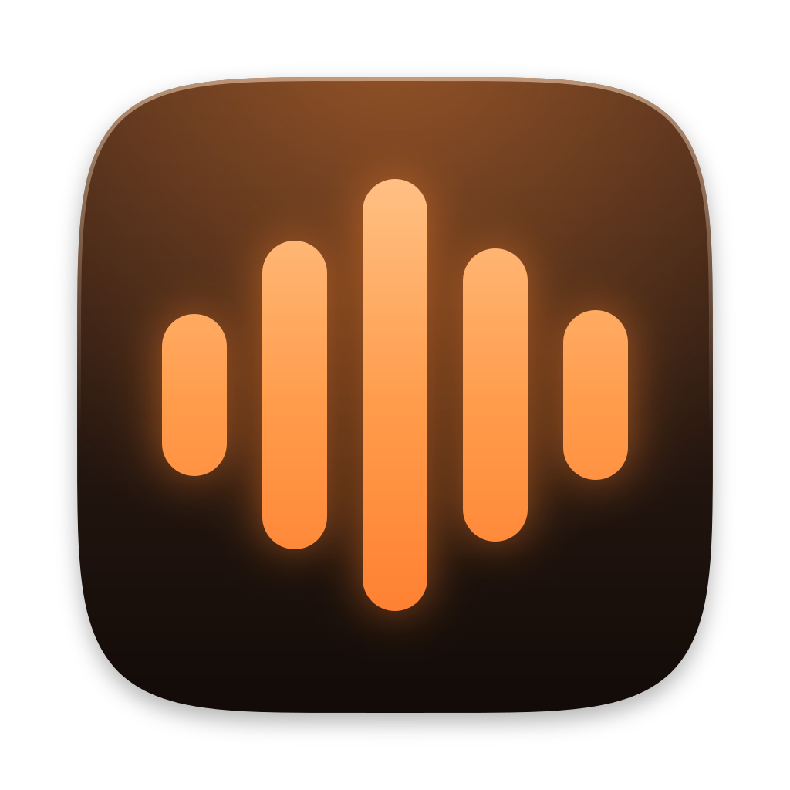

<p align="center">
  
</p>

<h1 align="center">Murmur</h1>

<p align="center">
  <strong>Mac の中だけで動く、プライベートな音声入力アプリ。</strong><br>
  ホットキーを押して話し、もう一度押す。カーソルの位置に文字が貼り付きます。
</p>

<p align="center">
  <a href="https://github.com/naoya5/murmur/releases/latest"></a>
  
  <a href="LICENSE"></a>
</p>

<p align="center">
  <a href="README.md">English</a> | 日本語
</p>

---

Murmur は、話した言葉を Mac の GPU で文字にします。停止から貼り付けまで 1 秒もかかりません。
アカウントもサブスクリプションも利用回数の制限もなく、音声も文字も Mac の外には出ません。

- **日本語と英語。** 日本語は [Haas-ja-v1.0](https://huggingface.co/third-intelligence/Haas-ja-v1.0)、
  英語は [NVIDIA Parakeet TDT 0.6B v3](https://huggingface.co/nvidia/parakeet-tdt-0.6b-v3)。
  どちらも [speech.cpp](https://github.com/nyosegawa/speech.cpp) で Metal の上で動きます。
- **作業の邪魔をしない。** 録音中は小さなガラスのピルが出るだけです。入力中のアプリからフォーカスを
  奪いません。
- **録音を失わない。** 結果はすべて Mac の中の履歴に残ります。録音のあとで何かが失敗しても音声は残り、
  もう一度文字にできます。`Esc` で取り消し、3 秒以内にもう一度 `Esc` で取り消しを元に戻せます。
- **言葉を覚える。** 辞書に「Claude Code」や「Tauri」のような名前や用語を登録できます。
- **成果が見える。** ダッシュボードに、節約できた時間、話す速さ、待ち時間、連続日数が出ます。

> [!NOTE]
> Murmur はバージョン 0.x です。Apple シリコンの Mac 専用で、Apple の公証 (notarization) を
> 受けていません ([インストール](#インストール) を参照)。

## 目次

- [動作環境](#動作環境)
- [インストール](#インストール)
- [使い方](#使い方)
- [モデル](#モデル)
- [実験的な機能](#実験的な機能)
- [プライバシー](#プライバシー)
- [困ったとき](#困ったとき)
- [アンインストール](#アンインストール)
- [ソースからビルド](#ソースからビルド)
- [開発に参加する](#開発に参加する)
- [ライセンスとクレジット](#ライセンスとクレジット)

## 動作環境

- macOS 14 Sonoma 以降
- Apple シリコンの Mac (M1 以降)
- 言語モデル 1 つにつき約 0.7 GB の空き容量

## インストール

1. [最新リリース](https://github.com/naoya5/murmur/releases/latest) から
   `Murmur_<version>_aarch64.dmg` をダウンロードし、Murmur を「アプリケーション」へドラッグします。
2. Murmur を開きます。公証を受けていない (公証には有料の Apple Developer アカウントが必要) ため、
   macOS は開発元を確認できないと表示します。**システム設定 > プライバシーとセキュリティ** を開き、
   下までスクロールして **このまま開く** をクリックします。これは最初の 1 回だけです。アプリ内の
   アップデートでは聞かれません。
3. ようこそ画面が 4 つの手順を案内します。マイクの許可、アクセシビリティの許可、話す言語のモデルの
   ダウンロード、試しの録音です。

Murmur は使う権限だけを、使う直前に求めます。

| 権限 | 用途 | 求めるとき |
|---|---|---|
| マイク | 声を録音する | 初期設定 |
| アクセシビリティ | 前面のアプリに `Cmd + V` で貼り付ける。許可しない場合は文字をコピーするので、自分で貼り付けます。 | 初期設定 |
| 画面収録 | 実験的な機能「画面アノテーション」だけで使う | その機能をオンにしたとき |

## 使い方

| 操作 | 既定 |
|---|---|
| 録音の開始と停止 | `Option + Space`。設定で変更できます。押している間だけ録音する方式も選べます。 |
| 取り消し | 録音中か文字起こし中に `Esc`。3 秒以内にもう一度 `Esc` で取り消しを元に戻します。 |
| 言語の切り替え | メニューバーのアイコン > 言語、または設定。もう一方の言語で録音する 2 つ目のホットキーも設定できます。 |
| 過去の結果をコピー | メニューバーのアイコン > 最近の文字起こし、または履歴の画面 |

貼り付けを受け付けない入力欄 (パスワード欄などのセキュアな入力) では、Murmur は文字をコピーし、
`Cmd + V` を押すよう伝えます。

## モデル

モデルはアプリの中で選んでダウンロードします。どのダウンロードも Hugging Face の固定したリビジョンから
取得し、使う前に SHA-256 で検証します。

| モデル | 用途 | サイズ | ライセンス |
|---|---|---|---|
| Haas-ja-v1.0 (Q8_0) | 日本語 (既定) | 656 MB | Apache-2.0 |
| Haas-ja-v1.0 Light (Q5_K) | 日本語、軽量版 | 428 MB | Apache-2.0 |
| Parakeet TDT 0.6B v3 (Q8_0) | 英語 (既定) | 668 MB | CC-BY-4.0 |
| Qwen3-ASR 0.6B (Q8_0) | 日本語と英語、任意 | 842 MB | Apache-2.0 |
| Silero VAD v6.2 | 発話を見つけ、無音をモデルに渡さない | 1.2 MB | MIT |
| Qwen3.5-2B (Q4_K_M) | 整形 (実験的) | 1.28 GB | Apache-2.0 |
| LFM2-350M-ENJP-MT (Q4_K_M) | 翻訳 (実験的) | 229 MB | LFM Open License v1.0 |

## 実験的な機能

どれも既定ではオフです。オフの間は、その機能のものは何も動きません (ホットキーも、プロセスも、
モデルも)。**設定 > 録音 > 実験的な機能** でオンにします。

| 機能 | 内容 |
|---|---|
| 整形 (LLM) | 日本語の音声入力を、貼り付ける前に Mac の中のモデルで軽く整えます (つなぎ言葉、言い直し、任意で箇条書き)。150 文字を超える文と、つなぎ言葉や言い直しのないごく短い文は整形しません。整形に失敗したときは、ルールで整えた文を貼り付けます。 |
| 翻訳 (日本語 → 英語) | 2 つ目のホットキー (既定は `Option + Shift + E`) で日本語を録音し、英語を貼り付けます。翻訳に失敗したときは何も貼り付けず、日本語をコピーします。 |
| 画面アノテーション | ホットキー (既定は `Option + Shift + S`) で声と画面を一緒に記録します。`Shift` を押しながらドラッグすると画面に描けます。停止すると、描いた画面の画像と、それぞれの線を指す印の入った文を貼り付けます。画像は既定で 7 日間 Mac に残ります。 |

整形と翻訳の言語モデルは別の補助プロセス (llama.cpp) で動き、5 分使わないと止まります。

## プライバシー

Murmur の通信は次の 2 種類だけです。

1. 選んだモデルを Hugging Face からダウンロードする。
2. GitHub Releases にアップデートがあるか確認する。設定でオフにできます。アップデートには署名があり、
   Murmur はインストールの前にその署名を検証します。

テレメトリ、利用状況の分析、クラッシュレポートはありません。言語モデルの補助プロセスはネットワークの
ソケットを開きません。ログに文字起こしの内容は書きません。

Murmur が保存するものは、すべて Mac の中にあります。

| 内容 | 場所 |
|---|---|
| 履歴、統計、設定 | `~/Library/Application Support/io.github.naoya5.murmur/` |
| ダウンロードしたモデル | 同じフォルダの `models/` |
| 復旧のために残す、終わっていない録音の音声 | 同じフォルダの `spool/` |
| 画面アノテーション | 同じフォルダの `annotations/` (自分のユーザーだけが読めます) |
| ログ (文字起こしの内容なし、7 日分) | `~/Library/Logs/io.github.naoya5.murmur/` |

履歴は、設定で保存期間を決めない限り、自分で消すまで残ります。

## 困ったとき

| 症状 | 対処 |
|---|---|
| Murmur を開けないと表示される | **システム設定 > プライバシーとセキュリティ** で **このまま開く** をクリックします ([インストール](#インストール) を参照)。 |
| コピーはされるが貼り付けられない | **システム設定 > プライバシーとセキュリティ > アクセシビリティ** で Murmur を許可します。パスワード欄などのセキュアな入力欄は貼り付けを受け付けないので、自分で `Cmd + V` を押します。 |
| 何も録音されない | **システム設定 > プライバシーとセキュリティ > マイク** で Murmur を許可し、設定で使うマイクを確認します。 |
| 結果が失敗した | 履歴の画面を開きます。失敗した録音は音声が残っているので、もう一度文字にできます。 |

[バグを報告する](https://github.com/naoya5/murmur/issues/new/choose) ときは、ログが役に立ちます。
ログに文字起こしの内容は入っていませんが、添付する前に中身を確認してください。

## アンインストール

1. **ログイン時に開く** がオンなら、設定でオフにします。メニューバーのアイコンから Murmur を終了します。
2. `/Applications/Murmur.app` をゴミ箱に入れます。
3. データとログを削除します (ダウンロードしたモデルと履歴も消えます)。

   ```sh
   rm -rf ~/Library/Application\ Support/io.github.naoya5.murmur \
          ~/Library/Logs/io.github.naoya5.murmur \
          ~/Library/Caches/io.github.naoya5.murmur \
          ~/Library/WebKit/io.github.naoya5.murmur
   ```

4. 与えた権限を取り消します。

   ```sh
   tccutil reset All io.github.naoya5.murmur
   ```

## ソースからビルド

Metal Toolchain を入れた Xcode 26 以降、Rust 1.90 以降、Node.js 24、pnpm 10、CMake が必要です。

```sh
git clone --recurse-submodules https://github.com/naoya5/murmur.git
cd murmur
brew install cmake
xcodebuild -downloadComponent MetalToolchain   # `xcrun metal --version` が失敗するとき
pnpm install
pnpm tauri dev                                 # 開発モードで起動
pnpm check                                     # lint、型、テスト、ガードレール
CI=true pnpm tauri build                       # リリース用の .app と .dmg
```

署名、エンドツーエンドのテスト、プルリクエストの流れは [CONTRIBUTING.md](CONTRIBUTING.md) (英語) に
あります。コードの地図は [docs/ARCHITECTURE.md](docs/ARCHITECTURE.md) (英語) です。

## 開発に参加する

バグの報告、修正、アイデアを歓迎します。まず [CONTRIBUTING.md](CONTRIBUTING.md) を読んでください。
コーディングエージェント (Codex、Claude Code など) は [AGENTS.md](AGENTS.md) に従います。
[行動規範](CODE_OF_CONDUCT.md) を守り、セキュリティの問題は [SECURITY.md](SECURITY.md) の方法で
非公開で報告してください。issue とプルリクエストは日本語でも英語でもかまいません。

## ライセンスとクレジット

Murmur は [MIT ライセンス](LICENSE) です。次のものを同梱、またはダウンロードします。

| コンポーネント | ライセンス |
|---|---|
| [speech.cpp](https://github.com/nyosegawa/speech.cpp) とその ggml のフォーク ([naoya5/speech.cpp](https://github.com/naoya5/speech.cpp) のフォークからビルド) | MIT |
| [llama.cpp](https://github.com/ggml-org/llama.cpp) ([llama-cpp-2](https://crates.io/crates/llama-cpp-2) クレート経由) | MIT |
| [Haas-ja-v1.0](https://huggingface.co/third-intelligence/Haas-ja-v1.0) (Third Intelligence) | Apache-2.0 |
| [parakeet-tdt-0.6b-v3](https://huggingface.co/nvidia/parakeet-tdt-0.6b-v3) (NVIDIA) | CC-BY-4.0 |
| [Qwen3-ASR](https://huggingface.co/Qwen) (Qwen チーム、任意) | Apache-2.0 |
| [Silero VAD](https://github.com/snakers4/silero-vad) (Silero Team) | MIT |
| [Qwen3.5-2B](https://huggingface.co/Qwen) (Qwen チーム、GGUF は Unsloth、実験的) | Apache-2.0 |
| [LFM2-350M-ENJP-MT](https://huggingface.co/LiquidAI/LFM2-350M-ENJP-MT) (Liquid AI、実験的) | LFM Open License v1.0 |

音声モデルの GGUF 変換は [sakasegawa](https://huggingface.co/sakasegawa) によるものです。
Parakeet TDT 0.6B v3 は CC-BY-4.0 で使用しています (帰属: NVIDIA)。全体の一覧はアプリの
**設定 > このアプリについて** にあります。
