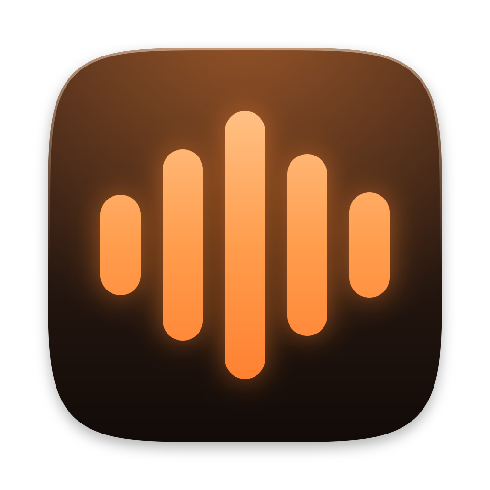

<p align="center">
  
</p>

<h1 align="center">Murmur</h1>

<p align="center">
  <strong>Local, private speech-to-text for macOS.</strong><br>
  Press a hotkey, speak, press it again. Your words are pasted where your cursor is.
</p>

<p align="center">
  <a href="https://github.com/naoya5/murmur/releases/latest"></a>
  
  <a href="LICENSE"></a>
</p>

<p align="center">
  English | <a href="README.ja.md">日本語</a>
</p>

---

Murmur turns speech into text on your Mac, on the Apple GPU, in well under a second. There is no
account, no subscription and no usage limit, and no audio or text ever leaves the machine.

- **Japanese and English.** Japanese with
  [Haas-ja-v1.0](https://huggingface.co/third-intelligence/Haas-ja-v1.0), English with
  [NVIDIA Parakeet TDT 0.6B v3](https://huggingface.co/nvidia/parakeet-tdt-0.6b-v3), both through
  [speech.cpp](https://github.com/nyosegawa/speech.cpp) on Metal.
- **Stays out of your way.** A small glass pill shows that you are recording. It never takes focus
  from the app you type in.
- **Never loses a recording.** Every result is kept in a local history. If anything fails after
  recording, the audio is kept and can be transcribed again. Press `Esc` to cancel, and `Esc`
  again within 3 seconds to undo the cancel.
- **Learns your words.** A dictionary teaches it names and terms such as "Claude Code" or "Tauri".
- **Shows your progress.** A dashboard shows the time you saved, your speaking rate, latency and
  streak.

> [!NOTE]
> Murmur is at version 0.x. It runs on Apple silicon Macs only and is not notarized by Apple
> (see [Install](#install)).

## Contents

- [Requirements](#requirements)
- [Install](#install)
- [Use](#use)
- [Models](#models)
- [Experimental features](#experimental-features)
- [Privacy](#privacy)
- [Troubleshooting](#troubleshooting)
- [Uninstall](#uninstall)
- [Build from source](#build-from-source)
- [Contributing](#contributing)
- [License and credits](#license-and-credits)

## Requirements

- macOS 14 Sonoma or later
- An Apple silicon Mac (M1 or newer)
- About 0.7 GB of disk for each language model you download

## Install

1. Download `Murmur_<version>_aarch64.dmg` from the
   [latest release](https://github.com/naoya5/murmur/releases/latest) and drag Murmur to
   Applications.
2. Open Murmur. macOS says that it cannot verify the developer, because the app is not notarized
   (notarization needs a paid Apple Developer account). Open **System Settings > Privacy &
   Security**, scroll down and click **Open Anyway**. You do this once; in-app updates do not ask
   again.
3. The welcome window walks you through four steps: microphone permission, accessibility
   permission, the model download for your language, and a test recording.

Murmur asks only for the permissions it uses, right before it uses them:

| Permission | Why | When |
|---|---|---|
| Microphone | To record your voice | Setup |
| Accessibility | To paste with `Cmd + V` into the app in front. Without it, Murmur copies the text and you paste it yourself. | Setup |
| Screen Recording | Only for screen annotations, an experimental feature | When you turn that feature on |

## Use

| Action | Default |
|---|---|
| Start and stop recording | `Option + Space`. Change it in Settings, or switch to push-to-talk (record while held). |
| Cancel | `Esc` while recording or transcribing. `Esc` again within 3 s undoes the cancel. |
| Switch language | Menu bar icon > Language, or Settings. You can also set a second hotkey that records in the other language. |
| Copy a past result | Menu bar icon > Recent, or the History window |

If a text field does not accept the paste (password fields and other secure input), Murmur copies
the text and tells you to press `Cmd + V`.

## Models

You choose and download models in the app. Each download comes from a pinned revision on Hugging
Face and is verified with SHA-256 before use.

| Model | Use | Download | License |
|---|---|---|---|
| Haas-ja-v1.0 (Q8_0) | Japanese (default) | 656 MB | Apache-2.0 |
| Haas-ja-v1.0 Light (Q5_K) | Japanese, smaller | 428 MB | Apache-2.0 |
| Parakeet TDT 0.6B v3 (Q8_0) | English (default) | 668 MB | CC-BY-4.0 |
| Qwen3-ASR 0.6B (Q8_0) | Japanese and English, optional | 842 MB | Apache-2.0 |
| Silero VAD v6.2 | Finds speech, so silence never reaches a model | 1.2 MB | MIT |
| Qwen3.5-2B (Q4_K_M) | Cleanup (experimental) | 1.28 GB | Apache-2.0 |
| LFM2-350M-ENJP-MT (Q4_K_M) | Translation (experimental) | 229 MB | LFM Open License v1.0 |

## Experimental features

These features are off by default. While a feature is off, nothing of it runs: no hotkey, no
process, no model. Turn them on in **Settings > Recording > Experimental**.

| Feature | What it does |
|---|---|
| Cleanup (LLM) | Lightly cleans up Japanese dictation (fillers, self-corrections, optional bullet lists) with a local model before the paste. Texts over 150 characters, and very short texts without fillers or corrections, skip it. If cleanup fails, the rule-formatted text is pasted. |
| Translation (Japanese to English) | A second hotkey (default `Option + Shift + E`) records Japanese and pastes English. If a translation fails, nothing is pasted and the Japanese is copied. |
| Screen annotations | A hotkey (default `Option + Shift + S`) records your voice and your screen. Hold `Shift` and drag to draw. At the stop, Murmur pastes the screens you drew on and your words, with marks that point to each drawing. Pictures are kept on your Mac for 7 days by default. |

The language models of cleanup and translation run in a separate helper process (llama.cpp),
which stops after 5 minutes without use.

## Privacy

Murmur makes exactly two kinds of network request:

1. Downloading a model that you chose, from Hugging Face.
2. Checking GitHub Releases for updates. You can turn this off in Settings. Updates are signed,
   and Murmur verifies the signature before it installs one.

There is no telemetry, no analytics and no crash reporting. The language-model helper opens no
network sockets. Logs never contain transcript text.

Everything Murmur keeps stays on your Mac:

| What | Where |
|---|---|
| History, statistics and settings | `~/Library/Application Support/io.github.naoya5.murmur/` |
| Downloaded models | `models/` in the same folder |
| Audio of an unfinished recording, kept for recovery | `spool/` in the same folder |
| Screen annotations | `annotations/` in the same folder, private to your user account |
| Logs (no transcript text, 7 days) | `~/Library/Logs/io.github.naoya5.murmur/` |

History is kept until you delete it, unless you set a retention period in Settings.

## Troubleshooting

| Problem | What to do |
|---|---|
| macOS says Murmur cannot be opened | Open **System Settings > Privacy & Security** and click **Open Anyway** (see [Install](#install)). |
| The text is copied but not pasted | Allow Murmur in **System Settings > Privacy & Security > Accessibility**. Secure input fields such as passwords never accept a paste; press `Cmd + V` yourself. |
| Nothing is recorded | Allow Murmur in **System Settings > Privacy & Security > Microphone**, and check the microphone that Settings uses. |
| A result failed | Open the History window. A failed recording keeps its audio and can be transcribed again. |

When you [report a bug](https://github.com/naoya5/murmur/issues/new/choose), the logs help. They
contain no transcript text, but read them before you attach them.

## Uninstall

1. If **Launch at login** is on, turn it off in Settings. Then quit Murmur from the menu bar icon.
2. Move `/Applications/Murmur.app` to the Trash.
3. Delete your data and logs (this also deletes the downloaded models and your history):

   ```sh
   rm -rf ~/Library/Application\ Support/io.github.naoya5.murmur \
          ~/Library/Logs/io.github.naoya5.murmur \
          ~/Library/Caches/io.github.naoya5.murmur \
          ~/Library/WebKit/io.github.naoya5.murmur
   ```

4. Remove the permissions that you granted:

   ```sh
   tccutil reset All io.github.naoya5.murmur
   ```

## Build from source

You need Xcode 26 or later with the Metal Toolchain, Rust 1.90 or later, Node.js 24, pnpm 10 and
CMake.

```sh
git clone --recurse-submodules https://github.com/naoya5/murmur.git
cd murmur
brew install cmake
xcodebuild -downloadComponent MetalToolchain   # if `xcrun metal --version` fails
pnpm install
pnpm tauri dev                                 # run the app in development
pnpm check                                     # lint, types, tests and guardrails
CI=true pnpm tauri build                       # release .app and .dmg
```

[CONTRIBUTING.md](CONTRIBUTING.md) covers signing, end-to-end tests and the pull request flow.
[docs/ARCHITECTURE.md](docs/ARCHITECTURE.md) is the map of the code.

## Contributing

Bug reports, fixes and ideas are welcome. Read [CONTRIBUTING.md](CONTRIBUTING.md) first. Coding
agents (Codex, Claude Code and others) follow [AGENTS.md](AGENTS.md). Please follow the
[Code of Conduct](CODE_OF_CONDUCT.md), and report security issues privately as described in
[SECURITY.md](SECURITY.md).

## License and credits

Murmur is [MIT licensed](LICENSE). It bundles or downloads:

| Component | License |
|---|---|
| [speech.cpp](https://github.com/nyosegawa/speech.cpp) and its ggml fork | MIT |
| [llama.cpp](https://github.com/ggml-org/llama.cpp), through the [llama-cpp-2](https://crates.io/crates/llama-cpp-2) crate | MIT |
| [Haas-ja-v1.0](https://huggingface.co/third-intelligence/Haas-ja-v1.0) by Third Intelligence | Apache-2.0 |
| [parakeet-tdt-0.6b-v3](https://huggingface.co/nvidia/parakeet-tdt-0.6b-v3) by NVIDIA | CC-BY-4.0 |
| [Qwen3-ASR](https://huggingface.co/Qwen) by the Qwen team (optional) | Apache-2.0 |
| [Silero VAD](https://github.com/snakers4/silero-vad) by Silero Team | MIT |
| [Qwen3.5-2B](https://huggingface.co/Qwen) by the Qwen team, GGUF by Unsloth (experimental) | Apache-2.0 |
| [LFM2-350M-ENJP-MT](https://huggingface.co/LiquidAI/LFM2-350M-ENJP-MT) by Liquid AI (experimental) | LFM Open License v1.0 |

GGUF conversions of the speech models by [sakasegawa](https://huggingface.co/sakasegawa).
Parakeet TDT 0.6B v3 is used under CC-BY-4.0; attribution: NVIDIA. The full list is in the app
under **Settings > About**.
